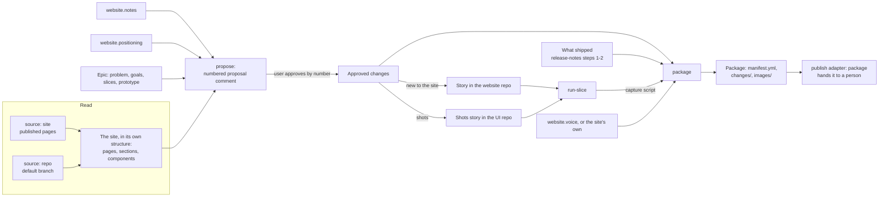

# Promote new features on the team's website (#125)

The design for epic [#125](https://github.com/Beakpoint-Insights/roost/issues/125): a `website-content` skill that works out what a feature should change on a team's marketing site, gets the user's approval, has roost build whatever the site needs, and hands over a package of copy and screenshots. The epic's description has the problem, goals and scope; this doc records how it's built and why.

## What it does

Two modes, at two moments in an epic:

- **`propose`**, once the epic's design is settled. Read the site, then post a numbered proposal on the epic: each change the feature should make to the site, where, of what kind, and why, with the screenshots ("shots") it needs. The user approves, cuts or edits by number. Approved changes that need something the site doesn't have, and the shots, become stories that `run-slice` builds like any other slice.
- **`package`**, once the epic is built (or nearly). Check what actually shipped, draft the copy for each approved change, capture the shots and keep only those that pass their assertions, and write the package: a manifest, one copy file per change, and the images. Its summary goes on the epic. Run it again to refresh the package at release time.

Nothing is published. A person places the package, until a later publish adapter does it for them.

## How it works



1. **Read the site.** Each source in `website.sources` reads the site fresh, in the structure its designers gave it (decision 1, 2).
2. **Propose.** From the site, the epic's facts, the team's positioning and its notes, a numbered comment on the epic (decision 3). Each image is a shot: a story with a scenario and assertions (decision 5).
3. **Approve.** The user answers by number; the comment is edited in place. Approved new-to-the-site changes and the shots become stories under the epic.
4. **Build.** `run-slice` builds those stories, unchanged.
5. **Package.** Copy written for each approved change and checked against what shipped, shots captured and asserted, all written as the package (decision 4).

## Config

```yaml
repos:
  # …the team's existing repos…
  - name: acme-site
    github: acme/acme-site
    role: website              # how roost finds the site's repo
    session: Site session
    order: 3
    owns: the marketing site: its pages, components and images
    tests: the site's build (npm run build), checked in its preview
    local_stack: false         # the site doesn't run on the product's stack
    production: merge

website:                       # optional; without it, the skill asks for the site's URL once
  url: https://acme.example
  sources: [site, repo]        # repo = the repos entry with role website
  kind: package                # the publish adapter; only package in v1
  notes: website-notes.md      # optional; team rules, relative to the config file
  positioning: positioning.md  # optional; audiences and solutions the site doesn't show
  voice: website-voice.md      # optional; without it, the voice is learned from the site
  screenshots:                 # optional; without it, no product shots are proposed
    repo: acme-ui              # where the shots story is built; default the repo with role frontend
    dir: scripts/website-screenshots
    data: mock                 # or seed
```

Only `url` is required. A team with no product UI (a plugin, say) leaves out `screenshots` and gets copy only.

## Decisions

### 1. The site is read fresh, in its own structure; only team rules are saved

**Chosen:** every run reads the site again and works from its pages, and each page's sections and components under the names they have in the repo or the markup. roost keeps no copy of the site. The proposal speaks in the site's terms ("add a slide to the `FeatureCarousel` on `/solutions/get-paid-faster`"). The only thing saved is `website.notes`, a file of what the team knows that the site doesn't show ("the homepage is off limits for single features", "pricing copy goes through legal"). It adds rules, never structure.

**Considered:** a saved "content inventory" that sorts the site into roost's own categories (feature pages, plan table, solution stories); a saved snapshot that mirrors the site's structure.

**Why:** sites market features in very different ways, and many have no feature list outside the plan table. Sorting a site into roost's categories replaces the designers' structure with roost's, and the proposal would then reason about roost's model instead of the site. A saved copy drifts from the site; reading a repo or a sitemap is fast enough to do every time. Team rules are the one thing the site can't tell roost, so they're the one thing kept.

### 2. Two source adapters, each reading what it's best at

**Chosen:** `website.sources` lists one or more:

- **`site`** reads the published site: pages from its `sitemap.xml` (or its navigation), each opened in a real browser (Playwright, an isolated session, never the shared signed-in one) for the rendered copy, the sections in page order, and each image's displayed and natural size. Its names come from the markup.
- **`repo`** reads the repo with `role: website`: routes and pages, the components each uses under their real names, the props and content that feed them, and image assets with their dimensions and formats.

With both, the repo is the authority on names and structure, the live site on what's live; where they disagree (a page in the repo that isn't live, live copy the repo doesn't hold because it comes from a CMS), the skill lists the difference rather than choosing. Both produce the same thing: the site as pages and their sections and components. A CMS API adapter, later, produces the same.

**Considered:** fetching the live site without a browser; using only the repo when both are named.

**Why:** the repo knows the designers' names but not what's deployed; the live site knows what's deployed but only by markup. A plain fetch misses content rendered by JavaScript and can't measure displayed images.

### 3. The proposal is a numbered comment on the epic

**Chosen:** one comment, each change numbered, saying:

- **where:** the page and the section or component, in the site's names, with the URL and the file path;
- **kind:** *edit* (change content that's there), *add* (another item in something the site has: a slide, a plan-table row), or *new to the site*;
- **why:** the audience or solution it serves, and the fact from the epic that backs it;
- **what it needs:** the copy, and the shots (decision 5);
- **for new to the site,** a spec: what the element is, how it behaves, the existing component it's closest to, and an example.

Then **considered, not proposed** (each place left out, and why, so the user can add it back), and which `website.notes` rules shaped it. The user answers in the conversation ("approve 1, 3; cut 2; 4: Growth plan only"); the comment is edited in place to show each change's state. Each approved new-to-the-site change becomes a story under the epic in the website repo, its spec as the description; the approved shots become one story in `website.screenshots.repo`. `run-slice` builds both. "Nothing" is a valid proposal.

**Considered:** a file in `team.drafts_dir`; a sub-issue per change.

**Why:** a comment lasts beyond the session, others can review it, and it sits on the epic it serves. Approving by number is one reply. Only build work needs the slice flow, so only build work becomes a ticket.

### 4. The package is a folder with a versioned manifest

**Chosen:**

```
<team.drafts_dir>/<epic key> website package/
  manifest.yml     # the contract publish adapters read; package: 1
  README.md        # for the person placing it, generated from the manifest
  changes/
    1-get-paid-faster-slide.md
    3-plan-table-row.md
  images/
    get-paid-faster-reminders.webp   # named the way the site names its images
```

For each approved change, the manifest has its proposal number, where it goes (URL, file path, component, position such as "after slide 2"), its kind, its copy file, its images (file, slot, size, format, alt text, and the shot it came from with its scenario, seed and assertion results), `waits_for` (the story a new-to-the-site change needs), and the facts still `[N]`. A copy file has one heading per field of the component (`title`, `body`, `cta`) when the repo shows them, or follows the live section's layout when there's no repo. The README's summary is posted on the epic, linking the proposal; the images stay in the folder.

**Considered:** one Markdown file with front matter for everything; committing the package to a branch of the site's repo.

**Why:** an adapter needs something it can parse, and a person needs files to read and copy from. Copy shaped to the component's fields is what lets a later repo adapter write it straight into the site. The version lets the format change without breaking adapters. Committing to the site's repo is publishing, which is a later adapter's job. GitHub attachments hold only text, so images in gists would help nobody.

### 5. Screenshots are shots: stories backed by scenarios, fed to the app through mocked API calls

**Chosen:** each image a change needs is a **shot** in the proposal: the story it tells ("one customer's margin goes negative within a month"), the screen and URL, the data the story needs, the assertions the image must pass ("exactly one customer has a negative margin"), and the capture spec (viewport, pixel ratio, full page and a crop of the main card, file names). Approved shots become one story in `website.screenshots.repo`, built by `run-slice`, which adds, in `website.screenshots.dir` and nowhere else:

- one **scenario** file per story (JSON): every number that matters, editable, with a seeded random generator for noise and dates taken from each request, so reruns give identical images and one edit changes every shot that uses it;
- a **generator** that turns a scenario and a request into responses that agree with each other and with the real API's rules;
- a **validator** that runs before any capture and fails loudly when a consistency rule or a shot's assertion breaks;
- a **capture** script.

No app code changes; when the UI doesn't match the spec, the session reports it rather than changing the UI. `website.screenshots.data` says how the data reaches the app: **`mock`** (the default) intercepts the UI's API calls in Playwright, so no backend or database runs; **`seed`** loads the scenario into the local stack, modelled on `stack.test_data`, for apps that can't be fed that way. Nothing real, ever. `package` runs the capture, and a shot that fails its assertions isn't packaged. It also looks at each image for fixture-looking data (`Test`, `Lorem`, zeros) or anything that looks real, and retakes or flags it. Without `website.screenshots`, no shots are proposed.

**Considered:** a `website.demo_data` key that seeds the local stack (falling back to `stack.test_data`); `mock` only.

**Why:** a screenshot sells only if it shows the feature working on data that looks like a business, and a shot of `Test Customer 1` owing $0.00 is the epic's failure case. Mocked responses from a scenario file are deterministic, need no backend, and are tied to the story the copy tells; the assertions prove the image shows it. Keeping the scenarios in the repo means the shots can be retaken at release time in the same state. This follows a real screenshot session run this way. Seeding stays for apps whose data can't come through API calls.

### 6. The site's repo is an ordinary repo; the `repo` source reads its default branch

**Chosen:** the site's repo is a `repos` entry with `role: website`, and `website.sources: [repo]` refers to it. The `repo` source reads the default branch from GitHub (a shallow clone into the state folder), not the session's checkout. `notes`, `positioning` and `voice` are files relative to the config file, like `release_notes.voice`. The site's voice is its own: it isn't `release_notes.voice`, and without the key it's learned from the site.

**Considered:** naming the site's repo only inside `website` (`website.repo`); reading the session's local checkout.

**Why:** as a `repos` entry, `run-slice` can drive the site's session to build new site elements, and the repo isn't named twice. Reading the default branch means the skill sees what's merged, not someone's work in progress, and can run from any session. A release note and a solution story don't sound alike.

### 7. One skill with two modes, and adapters as reference files: `skills/website-content/`

**Chosen:** `SKILL.md` with `propose` and `package`, plus `references/source-site.md`, `references/source-repo.md` and `references/publish-package.md`, each laid out like the tracker and tests adapters. `package` checks what shipped by following `release-notes` steps 1 and 2 (by reference, as `close-out-epic` reuses its production-date script), only as a fact check: the copy is written for audiences and solutions, not from the release note.

**Considered:** two skills (`website-proposal`, `website-package`); one mode that does everything in a single run.

**Why:** the two modes are two moments in an epic (what should change, before the build; what to place, after), and the proposal links them. One skill keeps that link, and its format, in one place. A single run couldn't wait for approval or let new site elements and shots be built alongside the epic. Adapters as files follow the pattern roost already has, so a CMS source or a repo publisher is a new file.

## Changes elsewhere

| Where | Change |
|---|---|
| `skills/roost-config/references/config-schema.md` | The `website` section, and `website` as a `repos[].role` |
| `skills/roost-config/SKILL.md` | `website.sources` and `website.kind` in the supported-values table |
| `scripts/check-references.py` | `website` added to the sections it knows |
| `examples/config.example.yml` | A site repo and a `website` section |
| `setup` | Asks about the site: its URL, whether it has a repo, notes and positioning, and whether the product has screens to shoot |
| `README.md`, `CONTRIBUTING.md` | The skill in the skills tables; its eval cases in the evals table |

`run-slice` doesn't change: the stories this skill creates are ordinary slices.

## Not in this epic

Publish adapters (a PR on the site's repo, a CMS), a CMS source adapter, and hooks that offer the skill from `shape-epic`, `close-out-epic`, `release-qa` or "where are we". Redesigning the site, creating a team's positioning from scratch, pricing, legal and SEO strategy, video and animated demos, and any data from a shared, deployed or production environment.
