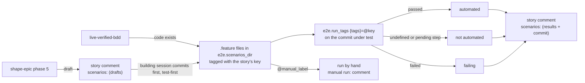

# Gherkin files in the repo as the test tool (#34)

The design for epic [#34](https://github.com/Beakpoint-Insights/roost/issues/34): `tests.kind: repo-gherkin`, a third tests adapter where a story's tests are Cucumber scenarios in the team's own `.feature` files, found by tag. The epic's description has the problem, goals and scope; this doc records how it's built and why.

## What it does

A team whose scenarios live in the repo sets `tests.kind: repo-gherkin`. Every skill that already goes through the tests adapter (`shape-epic` phase 5, `run-slice`, `verify-slice-tests`, `automate-tests`, `slice-handoff`, `release-qa`, `live-verified-bdd`) then reads and writes `.feature` files instead of Jira Test issues or eval cases. No skill gets a `repo-gherkin` branch of its own: the new adapter answers the same operations the other two do.

## How it works



1. **Shaping.** Phase 5 writes each test's scenarios in full and posts them on its story, in one comment starting `scenarios:`, a code block per file (decision 1).
2. **Building.** The session that builds the story commits those files first, in the story's PR. They fail before the change and pass after it.
3. **Verifying.** A story's tests are found by its tag (decision 2), run with the repo's existing `e2e.run_tags`, and sorted by Cucumber's own result (decision 3). The `scenarios:` comment is updated with each run.
4. **Manual checks** are tagged and closed by a recorded run (decision 4). **Scenarios that won't be automated** leave the suite (decision 5).

## Config

No new keys. The adapter reads what a repo's `e2e` already has:

```yaml
tests:
  kind: repo-gherkin
  manual_label: manual          # optional: turns manual scenarios on (decision 4)

repos:
  - name: acme-web
    e2e:
      run_all: npm run test:e2e
      run_tags: 'npm run test:e2e -- --tags "{tags}"'
      scenarios_dir: e2e/features/<area>/
      tag_style: "the story's key as a tag (@PROJ-1234)"
      backend_marker: "@backend"  # optional, unchanged meaning
```

`roost-config` stops if `tests.kind` is `repo-gherkin` and no repo has `e2e.scenarios_dir` and `e2e.run_tags`. With several repos that have `e2e`, a story's tests are searched for in each, and each is run in its own repo. `tests.automated_label` doesn't apply.

## Decisions

### 1. Scenarios are drafted on the story and committed test-first by the building session

- **Chosen:** phase 5 posts each test's full `.feature` text in a `scenarios:` comment on its story; the session that builds the story commits them first. This is what `evals` does.
- **Considered:** `shape-epic` commits the files on a branch in the team's repo. Rejected: shaping would open branches and PRs in every repo with scenarios, before any planning, and they'd go stale while the slice waits.
- **Code that already runs** (`live-verified-bdd`): when the session is in the repo that holds the scenarios, it writes the file on its current branch; otherwise it drafts on the story, the same as phase 5.

### 2. A test is one file's scenarios tagged with the story's key

- **Chosen:** a story's tests are the `.feature` files with at least one scenario carrying the story's tag (on the scenario, or inherited from the `Feature:` line). Each file is one test; its scenarios are the tagged ones in it. The tag is the story's key, written as `e2e.tag_style` and the tracker adapter's "Keys" say (`@issue-123` with GitHub, `@PROJ-123` with Jira). Match the whole tag, never a prefix, so `@issue-42` doesn't pick up `@issue-420`.
- **Considered:** a whole file is the test, with the tag only on `Feature:`. Rejected: teams keep one file per area with scenarios from many stories. Each scenario is its own test. Rejected: tables get long, and "split" means nothing.
- **Cross-cutting:** a scenario that needs several stories is tagged with the last one it depends on, as in the other adapters.

### 3. Automated is decided by a run, and recorded on the story

- **Chosen:** run the story's tag with `e2e.run_tags`. Cucumber's result sorts each scenario: **passed** is automated; **undefined** or **pending** (a step with no definition, or one marked pending) is not automated; **failed** is failing. Every scenario of a test must pass for the test to be automated. The record is the story's `scenarios:` comment, updated in place: each test, each scenario's result, and the commit. There's no label or status to set.
- **Considered:** a `tests.repo_gherkin.dry_run` key, to find missing step definitions without running. Rejected: another key per team, a flag that differs between Cucumber flavours, and a real run reports undefined steps anyway.
- **Backend scenarios** keep `e2e.backend_marker`'s meaning: the scenario names a test in another repo, and that test's result is the scenario's.

### 4. Manual scenarios are tagged, and closed by a recorded run

- Only when the config has `tests.manual_label`. The scenario carries `@<manual_label>`; its Gherkin description (the free text under `Scenario:`) says the environment, the steps and what passing looks like, and `When: after release` if it can only pass after the epic ships.
- A whole file is all manual or all automated, as in Xray.
- The team's run commands exclude the tag (`not @manual`); `setup` says so when it turns manual scenarios on.
- Closed by a `manual run:` comment on the story: date, who ran it, the environment, a pass or fail for each scenario, and the evidence. Never reported as "not automated".
- **Considered:** no manual tests, as with `evals`. Rejected: teams with infrastructure checks would lose something Xray teams have.

### 5. Scenarios that won't be automated leave the suite

- **Chosen:** when `verify-slice-tests` proposes a split and the user agrees, the automated scenarios stay; the rest are deleted from the file in the PR, and each one's check moves into the story's acceptance criteria, or becomes a manual scenario if those are on.
- **Considered:** tag them `@wip` and exclude it from runs. Rejected: parked scenarios pile up, nobody checks them again, and the suite looks complete when it isn't.

### 6. Smaller choices

- **`Background:` is allowed,** and so is a `Feature:` line: they're ordinary Gherkin here. "Shared setup" is a `Background:` in the file, or steps the files share.
- **Retiring a test:** delete its scenarios in a PR that says why, and say so on the story, as `evals` does.
- **Updating scenarios:** edit the file in the PR. Never change a scenario to make it pass, only when the behaviour deliberately changed, saying why.

## The adapter's operations

`skills/roost-config/references/tests-repo-gherkin.md` will hold this table, with the sections the decisions name:

| Operation | With Gherkin files in the repo |
|---|---|
| **A story's tests** | The `.feature` files under each `e2e.scenarios_dir` with scenarios carrying the story's tag (decision 2), plus any drafted in its `scenarios:` comment and not committed yet. |
| **Read a test's scenarios** | The tagged scenarios in the file, with its `Background:`. |
| **Find a scenario's automation** | Its step definitions, as the run reports them: a scenario with no undefined or pending steps has automation; a `e2e.backend_marker` scenario points at a backend test. |
| **Run a test** | `e2e.run_tags` with the story's tag, in the file's repo, on the commit under test. |
| **Mark a test automated** | No label: update the story's `scenarios:` comment with each scenario's result and the commit (decision 3). |
| **Write scenarios** | Cucumber scenarios in the `live-verified-bdd` style guide; `Feature:` and `Background:` allowed; tagged with the story's key. |
| **Unmark a test** | A test that passed before and fails now: say so in the `scenarios:` comment, with the failing scenario and the commit. |
| **Create a test** | Before the code exists, draft it on the story (decision 1); the building session commits it first. `create-xray-test` isn't used. |
| **Update a test's scenarios** | Edit the file in the PR (decision 6). |
| **Split a test** | Decision 5. |
| **Retire a test** | Decision 6. |
| **Shared setup** | A `Background:`, or shared steps. Never a ticket. |
| **Manual tests** | Decision 4, when the config has `tests.manual_label`. |

Its "In a prompt" line: "The Cucumber scenarios for each story: those in the repo tagged with its key, and the drafts in its `scenarios:` comment, which you commit first, test-first."

## Changes elsewhere

- `skills/roost-config/SKILL.md`: `repo-gherkin` moves to supported in the table (line 59); the adapter list (line 74) names `tests-repo-gherkin.md`; the check that a repo has `e2e.scenarios_dir` and `e2e.run_tags`.
- `skills/roost-config/references/config-schema.md`: `tests.kind` gains `repo-gherkin`; `manual_label` and `e2e` say they apply to it.
- `skills/setup/SKILL.md`: the tests question offers "Gherkin files in the repo", reads the repos' Cucumber config to suggest `e2e`, and says to exclude the manual tag from run commands.
- `README.md`: the support table moves it out of "not yet".
- `examples/`: a `config.repo-gherkin.example.yml`, or a commented alternative in the existing example, whichever the stories find clearer.
- Any skill step whose wording assumes a test is a ticket is reworded in the operation's terms, not branched.
- Eval cases: `setup` offering it, phase 5 drafting a `scenarios:` comment, and `verify-slice-tests` sorting passed, undefined and failed scenarios.

## Not in this epic

`tests.kind: none`; BDD runners other than Cucumber; moving a team's tests between Xray and the repo; generating step definitions (`automate-tests`' job, unchanged).
