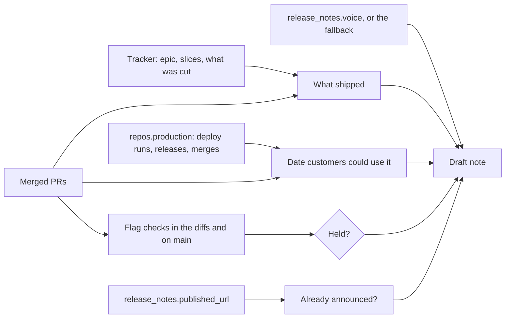

# Release notes that match what shipped (#56)

The design for epic [#56](https://github.com/Beakpoint-Insights/roost/issues/56): a `release-notes` skill that drafts customer-facing release notes from the evidence roost already reads, in the team's voice. The epic's description has the problem, goals and scope; this doc records how it's built and why.

## What it does

Two modes:

- **One epic:** draft the note for an epic that has shipped. `close-out-epic` offers this once production runs the epic's code.
- **Catch-up:** given a date (usually the last published post), find everything released since then. Each epic gets a note; standalone stories, tasks and customer-visible bugs are listed as candidates, drafted only if the user picks them.

Every note is dated by when customers could first use it, written from what shipped, held when customers can't use it yet, checked against what's already published, and written in the team's voice. All notes come in one paste-ready message, oldest first, with every check and question in one short list at the bottom.

## How a note is built



1. **Find the work.** One epic: the epic, its slices and the PRs that closed them, through the tracker adapter. Catch-up: epics and tickets moved to `tracker.statuses.done` or `tracker.statuses.ready_for_release` since the date (decision 5).
2. **What shipped.** Read the slices and their merged PRs, not only the epic's plan. Anything planned but not built is left out and listed for the user to check.
3. **When customers could use it.** For each repo the feature needed, the first production deploy that included its last change, found the way `repos[].production` says (decision 1). The feature's date is the latest of those. Shown in one evidence table: repo, last change, deploy, date. Never the tracker's resolution date.
4. **Can customers use it yet?** Flag checks in the merged diffs and the code around them on `main` (decision 4), slices not yet released, and corrections to past data that haven't run. Any of these and the note is drafted but held, saying what it's waiting for; its date is `[date]`, the day it goes live for everyone.
5. **Already announced?** Fetch `release_notes.published_url` and drop or flag anything it already covers (decision 3).
6. **Write it** in the team's voice (decision 2), leaving any fact the evidence doesn't give as `[N]`, listed in the checks.

## Config

```yaml
release_notes:                     # optional section
  voice: release-notes-voice.md    # relative to this config file
  published_url: https://acme.example/changelog

repos:
  - name: acme-api
    production: { workflow: deploy-production.yml }   # its successful runs
  - name: acme-ui
    production: merge                                 # merging to main deploys
  - name: acme-cli
    production: release                               # the published release's date
```

A team without `release_notes` gets the fallback voice and no repeat check (the report says so). A repo without `production` gets "date not found" with the evidence the skill did find, never a guess.

## Decisions

### 1. Each repo says how its production date is found: `repos[].production`

**Chosen:** a key on each repo: `{ workflow: <file> }` (that workflow's successful runs on the default branch or a tag), `release` (the published GitHub release's date), or `merge` (merging to `main` deploys).

**Considered:** a map under `release_notes`, keyed by repo name.

**Why:** how a repo reaches production is a fact about the repo, not about release notes. On the repo, other skills can use it too: `close-out-epic` step 6 has to confirm "the production deploy that carries its release has run", and this tells it where to look. A map under `release_notes` would repeat the repo list and drift from it.

### 2. The voice is one Markdown file: `release_notes.voice`

**Chosen:** one key, a path to a Markdown file relative to the config file, holding every rule: titles, categories, length, word choice, sign-offs and byline.

**Considered:** `voice` plus separate `signoffs` and `byline` keys, as the issue sketched.

**Why:** voice rules are prose, and sign-offs and bylines are part of the voice ("rotate them, never repeat one in a batch" is a rule, not a list). One file is one place to read and to correct, and it lives in the team's config repo, where they already edit roost's settings. Without the key, roost's fallback applies (decision 6).

### 3. Published notes are read from a URL: `release_notes.published_url`

**Chosen:** a URL the skill fetches. If it can't be read, the report says the repeat check wasn't done, and every note gets a "check it isn't already announced" line.

**Considered:** also accepting a path in one of the repos, for a team whose notes live in its docs site.

**Why:** every team that publishes notes has a URL. A repo path is easy to add once a team needs it; until then it's one more form to document and test.

### 4. Flags are found in the code, with no config

**Chosen:** read the merged PRs' diffs, and the code around them on `main`, for feature-flag checks from any library. A flag found means the note is held with "check the flag's rollout". Reading the rollout from a flag provider is out of scope.

**Considered:** a `release_notes.flag_patterns` key naming the team's flag calls.

**Why:** flag checks are easy to recognise in a diff whatever the library, and a key would be one more thing to set up before the skill works. If evals or real runs show misses, a key can be added then.

### 5. Catch-up starts from the tracker

**Chosen:** epics and tickets moved to done or ready-for-release since the date, each then dated from its deploys; one whose production date is before the cut-off is dropped.

**Considered:** starting from production deploys since the date and mapping their changes back to tickets.

**Why:** the tracker already groups work into what customers would recognise (an epic, a story), and every roost-built change is linked to a ticket. Starting from deploys catches untracked work, but it's slower and noisier, and untracked work is rare in a team using roost.

### 6. The skill and its fallback voice: `skills/release-notes/`

**Chosen:** `SKILL.md`, plus `references/fallback-voice.md`.

**Considered:** everything in `SKILL.md`.

**Why:** a separate fallback is a file a team can copy as the start of its own `release_notes.voice`, and `setup` can point at it. The fallback is generic: plain titles, a short honest body, "Previously… Now…", one practical closing line, no hype, no ticket keys or internal names. No team's sign-offs, brand or product names.

## Changes elsewhere

| Where | Change |
|---|---|
| `skills/roost-config/references/config-schema.md` | The `release_notes` section and `repos[].production` |
| `scripts/check-references.py` | `release_notes` added to the sections it knows |
| `examples/config.example.yml` | Both keys, with `production` on each repo |
| `examples/config.github-only.yml` | `production: release` on its plugin repo; no `release_notes` (a plugin with no customer notes) |
| `close-out-epic` step 6 | Uses `repos[].production` to confirm production runs the release, then offers to draft the epic's note |
| `setup` | Asks for `production` per repo, and for the voice rules: a path, or offers to work them out from the published notes and shows them for the user to correct before saving |
| `README.md`, `CONTRIBUTING.md` | The skill in the skills tables; its eval cases in the evals table |

## Not in this epic

Publishing notes, reading a flag provider's rollout, developer changelogs (release-please writes those), translations and screenshots. A team's own voice rules live in its config repo, not in roost.
