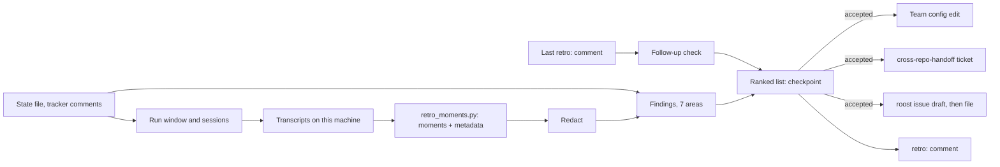

# retro: carry each run's lessons into the setup (#92)

The design for epic [#92](https://github.com/Beakpoint-Insights/roost/issues/92): a `retro` skill that reads a finished run's sessions and suggests changes to the setup they ran in. The epic's description has the problem, goals and scope; this doc records how it's built and why.

## What it does

After a run (a slice, a bug, an epic, or any roost session the user names), `retro`:

1. **Checks the last retro's follow-ups:** each suggestion it accepted is done (with the evidence), still open (with its ticket), or dropped (with the reason).
2. **Finds the run's sessions:** the orchestrator's transcript and each repo session's, on this machine.
3. **Filters them** with a script down to the moments worth reading: corrections, refusals, errors, retries, long searches and stops.
4. **Reads those moments** with the state file and the run's tracker comments, and writes findings in seven areas.
5. **Shows one ranked list** at a checkpoint: each finding with its evidence, what skipping it costs, a recommendation and where the change goes. Nothing changes until the user decides.
6. **Gives each accepted finding its home:** a config edit for the user to make, a `cross-repo-handoff` prompt on a ticket for a repo, or a roost issue (drafted, then filed once the user approves it).
7. **Posts a `retro:` comment** on the run's story, bug or epic listing what was accepted and where each went. The next retro starts there.

It's read-only until step 6, and it never edits a repo, the team config or roost itself.

## Decisions

### 1. Transcripts are found from what the orchestrator sent them

**Chosen:** the run's window comes from the state file (the slice's start time to its end) or, without one, from the story's first kickoff comment to its last `run-slice checkpoint:` comment. The orchestrator's transcript is the one that sent the run's kickoffs. Each repo's sessions are the transcripts in that repo's project folder (`~/.claude/projects/<working directory with / as ->/`) that were active during the window and contain a message the orchestrator sent (the connectivity check, a kickoff, a fix list). Run on request without a run (a single session the user names), it reads only that session.

**Considered:** `run-slice` and `build-epic` recording each session's transcript path in the state file in step 0.

**Why:** a `ListAgents` ref isn't a session id (this design's own session is ref `0e3260`, transcript `40e81a18….jsonl`), names change, and a session can't reliably name its own transcript. The orchestrator's messages are in the recipient's transcript word for word, so they identify it. It also works for runs that happened before this epic, which is how the epic's success metric is measured (a retro on #56 and #72).

**Also:** `run-slice` finds a session's last turn as "the newest transcript in the repo's project folder" (`skills/run-slice/SKILL.md:128`), which picks the wrong file when two sessions share a repo. It changes to the same lookup, through the same script.

### 2. A script filters transcripts first: `scripts/retro_moments.py`

**Chosen:** a Python script (Python, per #72's decision) that takes transcripts and a time window and prints a short JSON list of moments, each with its session, time, record id, kind and a trimmed excerpt:

| Kind | What it looks for |
|---|---|
| `correction` | The user's own messages after the first, in the orchestrator and in repo sessions (they rarely type there, so each one counts) |
| `refusal` | A tool call refused by a permission check, a hook, or a cross-session delivery notice |
| `error` | A tool result marked as an error, with the command or tool and its first lines |
| `retry` | The same tool call (same tool, same input) repeated within a few turns |
| `search` | A run of reads and searches before the first edit or answer, with its count and duration |
| `slow` | A tool call or gap between turns over a threshold |
| `stop` | A turn that ended waiting on the user, with what it asked |
| `blocked` | A known blocker: commit signing (`vcs.signing_errors`), a usage limit, a sign-in |

It also prints totals per session (turns, tool calls by tool, errors, time) so tool-use findings can cite counts. The model reads the moments, and opens the transcript around a moment only when it needs more context.

**Considered:** having the model read the transcripts directly.

**Why:** transcripts are large (the roost repo's nine are 73 MB, and one session runs past 2 MB) and mostly tool output. A script is free to run, testable with fixtures in `scripts/fixtures/`, and gives the model the same moments every time. The transcript format is Claude Code's and isn't documented, so the script reads only the fields it needs (record type, timestamp, message content blocks, `is_error`) and reports records it can't parse instead of failing.

### 3. Seven areas, each with its kind of fix

| Area | What counts | Where the fix goes |
|---|---|---|
| **Finding things** | A long `search` for a file or fact that a pointer would have saved | The repo's agent instructions, or the team config (`repos[].owns`, `stack`) |
| **Automated checks** | A mistake a deterministic check could catch: a banned API, a file location, an import shape. A repo with no checks at all is a finding in itself | A lint rule, hook or CI job in the repo, never a sentence in a doc |
| **Review rules** | Something a review let through that a standing rule should have caught | The repo's `review_focus` (team config) or its coding standards |
| **Agent instructions** | `CLAUDE.md`/`AGENTS.md` content the agent ignored, that's too long, or belongs in standards or a check | The repo |
| **Tool use** | Expensive or repeated calls that a script or a narrower command could replace | The repo (a script), or roost (a skill's step) |
| **Access** | Information the agent needed and couldn't get (server logs, a read-only view of a service) | The team config (`stack.telemetry`, a read command) or a person-owned setup task |
| **roost itself** | A skill that stopped when it shouldn't have, didn't stop when it should, guessed, or asked something it could have read | roost, as an issue |

**Why:** the fix decides who has to act, and the epic's goal 3 is that a mechanical rule becomes a check and a review miss binds the reviewer, not the writer. A finding names its area, so its destination follows from it.

### 4. A finding says what skipping costs, and ranks by cost and recurrence

**Chosen:** each finding has: area, what happened, evidence (a quote and its session and time, or a state-file line), what skipping it costs with a concrete case (the shape #99 sets for every checkpoint finding), recommendation, and destination. Ranked by severity:

- **High:** a wrong result shipped or nearly shipped, a trust break (the user had to check the agent's work to catch it), or a recurrence (decision 5).
- **Medium:** time lost on every run (a repeated search or blocker), or a skill misbehaving without a wrong result.
- **Low:** one-off friction.

A finding with no evidence in the transcripts or the tracker isn't reported.

**Considered:** a numeric score.

**Why:** three levels are enough to order a list the user reads top to bottom, and a score would look more precise than the evidence is. Matching #99 now means the retro's findings read like every other checkpoint's once #99 ships.

### 5. Follow-ups live in a `retro:` comment

**Chosen:** after the checkpoint, a comment on the run's story, bug or epic starting `retro:`, with the date, the run, and one row per accepted finding: area, finding, destination and its link (ticket, handoff comment, or "config edit, for the user"). Rejected findings are listed by title only, so a recurrence can be recognised. The next retro searches the tracker for the team's most recent `retro:` comments and checks each accepted row: done (the ticket closed, the config has the change, the check exists), still open (its ticket), or dropped (the reason, if the user gave one). A finding that matches an earlier accepted or rejected one, unaddressed, ranks one level higher and says how many runs it has come back on.

**Considered:** a file in the state directory.

**Why:** the state directory is one machine's. The comment is shared, lives with the run it came from, and the tracker adapters already know how to search comments.

### 6. Redaction uses the team config as its list of private details

**Chosen:** before any quote leaves the session (into the checkpoint, a ticket, a handoff, the `retro:` comment or a roost issue), the script redacts:

- generic secrets: tokens and keys by pattern, connection strings, private keys, `Authorization` headers, email addresses;
- every identifying value in the loaded team config and its overrides: the tracker site and IDs, hostnames, URLs, IP addresses, the test account pattern.

A draft bound for roost's tracker goes further: the team's names (team, product, repos, ticket keys) become roost's example names (Acme, `PROJ-1234`, `acme-api`), and the draft is checked with `scripts/check-private-details.sh`'s matching against the same list before it's shown. If a value can't be redacted with confidence, the quote is dropped and the finding cites its session and time instead.

**Considered:** generic patterns only.

**Why:** roost's tracker is public, and a team's config is exactly the list of what's private to it. Generic patterns alone would leak a tracker site or cloud ID into a public issue.

### 7. A roost issue is drafted, then filed once the user approves it

**Chosen:** a "roost itself" finding the user accepts becomes a draft in roost's format: a bug (skill, what happened, steps to reproduce, roost version, coding agent, as in `.github/ISSUE_TEMPLATE/bug_report.yml`), or, for a missing capability, an epic with a Real-World Failure Case Study filled in from the evidence. The user sees the redacted draft; once they approve it, the retro files it with `gh` in Beakpoint-Insights/roost and links it in the `retro:` comment. Findings about the team's own setup are never filed in roost.

**Why:** filing for the user saves a copy-paste, and approval of the exact text is the guard, since the issue is public the moment it's filed.

### 8. The skill and where it's offered

**Chosen:** `skills/retro/SKILL.md`, plus `references/finding-areas.md` (decision 3's table with examples of each area). Offered at the end of `slice-handoff`, `run-bug` and `close-out-epic` as one line ("Run a retro on this run?"), and run on request ("retro on PROJ-X", "retro on this session"). No new config section.

**Considered:** a `retro` config section (thresholds, which areas to check).

**Why:** the thresholds live in the script with sensible defaults, and every team needs all seven areas. A key can be added when a real team needs one.

## Changes elsewhere

| Where | Change |
|---|---|
| `scripts/retro_moments.py`, `scripts/retro_moments.test.py`, `scripts/fixtures/` | The filter and redaction, with transcript fixtures (including planted secrets) |
| `skills/run-slice/SKILL.md` | Step "How to talk to the sessions": find a session's last turn by the orchestrator's messages, through the script, not the newest file |
| `skills/slice-handoff/SKILL.md`, `skills/run-bug/SKILL.md`, `skills/close-out-epic/SKILL.md` | Offer a retro in their report |
| `skills/roost-config/references/tracker-github.md`, `tracker-jira.md` | A "Find `retro:` comments" search |
| `evals/` | Cases for each area, the follow-up check, redaction, and the roost-issue draft |
| `README.md`, `CONTRIBUTING.md` | The skill in the skills table; its eval cases in the evals table |

## Not in this epic

Editing a repo, the team config or roost itself; transcripts on another machine or in the cloud; watching a run while it's going; scoring sessions or people; the checks #93 (an epic's parts agree) and #100 (a ledger of shortcuts) do. Findings about one team's own setup stay in that team's tracker.
